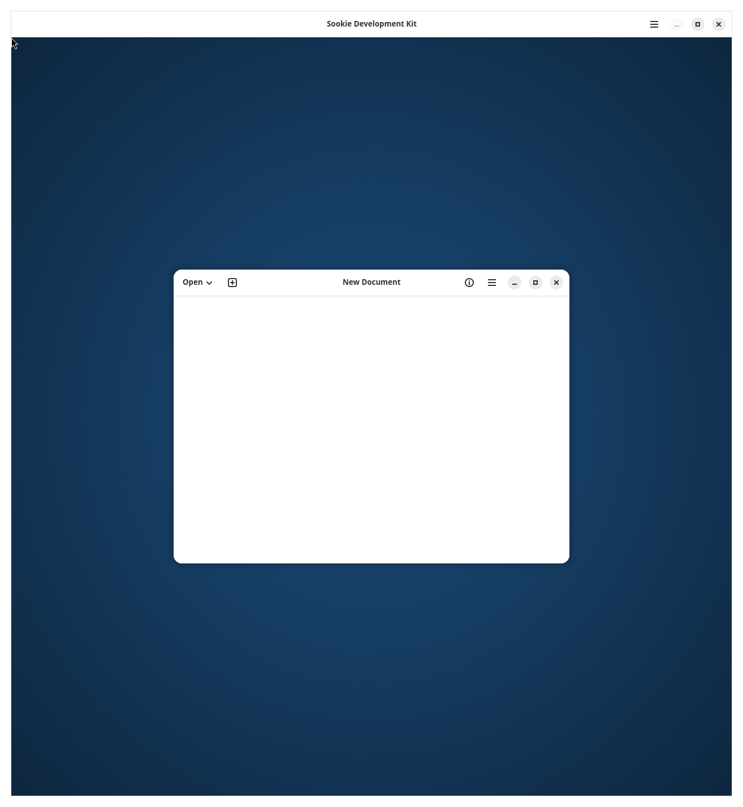

<div align="center">


# Sookie

The compositor behind [Cali](https://github.com/CaliDE-Foundation/DE). A fork of GNOME's Mutter.

[](https://github.com/CaliDE-Foundation/Sookie/actions/workflows/build.yml)



</div>

## Build

```sh
meson setup _build -Dtests=disabled
meson compile -C _build
dbus-run-session ./_build/src/sookie --wayland --devkit
```

Or grab the [nightly build](https://github.com/CaliDE-Foundation/Sookie/releases/tag/nightly) (Fedora 45).

GPL-2.0-or-later. Based on [Mutter](https://gitlab.gnome.org/GNOME/mutter); not affiliated with GNOME.
